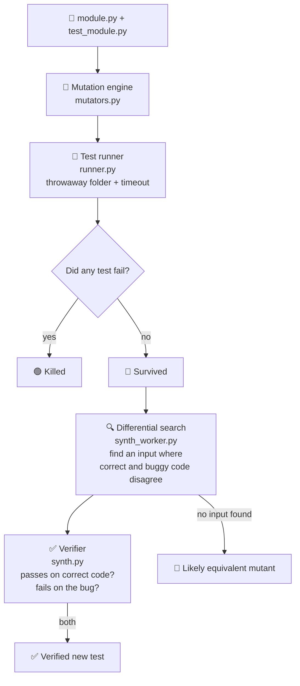

<div align="center">

# 🧪 Your Tests Are Lying

### Finds the bugs your tests miss, then writes and verifies the missing tests.


</div>

---

## 💡 The idea

A test suite can pass every time and cover most of the code, yet still miss
real bugs. This tool measures how good tests actually are: it plants bugs in
the code on purpose and checks whether the tests notice. For every bug that
slips through, it writes a new test and **proves** the test works before
keeping it.

Works fully offline. No API key, no internet, no paid service.

> **Example:** `letter_grade()` gives "S" for 90 and above. The tests check 95 → S
> and 30 → U, and both pass. Change `>= 90` to `> 90` and a student with exactly
> 90 marks now gets A+ instead of S, **and every test still passes.** This tool
> finds that gap and writes `assert letter_grade(90) == "S"`.

## 📊 Results on the included samples

| Sample | Line coverage | Mutation score (before) | Mutation score (after generated tests) |
|---|---|---|---|
| `samples/pricing` | 90.9% | 46.4% | 100% |
| `samples/grades` | 78.3% | 31.2% | 100% |

The pricing tests execute 91% of the lines, but catch fewer than half of the
planted bugs. That gap is the point of the project.

## ⚙️ How it works



### 🏷️ Result categories

| Status | Meaning |
|---|---|
| 🟢 Killed | at least one test failed on the mutant |
| 🟡 Timed out | tests didn't finish (e.g. a mutant caused an infinite loop); counted as detected, as tools like PIT and mutmut do |
| 🔴 Survived | every test passed on buggy code: a gap in the tests |
| ⚪ Invalid | the mutant doesn't compile; excluded from the score |

**Mutation score = (killed + timed out) / (killed + timed out + survived) × 100**

### 🧬 Mutation operators

| Code | Name | Example |
|---|---|---|
| ROR | Relational operator replacement | `x >= 10` → `x > 10` |
| LCR | Logical connector replacement | `a or b` → `a and b` |
| AOR | Arithmetic operator replacement | `a + b` → `a - b` |
| CRP | Constant replacement in comparisons | `x >= 10` → `x >= 11` |
| RVR | Return value replacement | `return 0.2` → `return 0` |
| NEG | Condition negation | `if x:` → `if not x:` |

### 🔍 Generating tests without AI

For a surviving mutant, the search collects boundary values from the code
itself (every numeric and string constant, plus neighbours like `c - 1`,
`c + 1`, `c ± 0.01`), builds argument combinations from the function's type
hints, and calls both versions. The first input where the outputs differ
becomes a test asserting the **original's** output (the original is the
oracle). Example generated test:

```python
def test_catches_m06_bulk_discount():
    assert bulk_discount(50) == pytest.approx(0.2)
```

### 🟰 Equivalent mutants

Some changes don't alter behaviour at all, so no test can catch them.
Deciding this exactly is undecidable in general. When the search finds no
differing input, the tool labels the mutant **likely equivalent** rather than
claiming it's proven.

## 🚀 Run it

```bash
pip install -r requirements.txt
python -m streamlit run app.py
```

Tests for the tool itself (11 tests, including a real infinite-loop mutant):

```bash
python -m pytest
```

Command line:

```bash
python cli.py samples/pricing
python cli.py samples/pricing --write-tests
```

In the app you can also upload your own module and its pytest file.

## 🤖 Optional AI mode

Not required. In the sidebar, point it at any OpenAI-compatible API, for
example a local [Ollama](https://ollama.com) model at
`http://localhost:11434/v1`. AI mode adds realistic bugs the rules can't
express and writes tests for survivors the search can't handle. AI output is
treated as untrusted: every patch must match the source exactly once and
compile, and every test goes through the same verifier.

## 📁 Project structure

| File | Role |
|---|---|
| `mutators.py` | AST-based mutation operators |
| `runner.py` | Isolated pytest runs, coverage, mutation score |
| `synth_worker.py` | Differential input search (separate process, timeout) |
| `synth.py` | Test generation and verification |
| `llm.py` | Optional AI mode |
| `app.py` | Streamlit interface |
| `cli.py` | Command-line interface |
| `samples/` | Two example modules with deliberately weak tests |
| `tests/` | Tests for the tool itself |

## ⚠️ Limitations

- Search-based test generation handles functions with `int`, `float`, `bool`
  and `str` parameters. Lists, objects and files need AI mode or manual tests.
- Uploaded code runs on your machine (in a temp folder with a timeout, but
  not a full sandbox). Only run code you trust.
- Single-module projects only.

## 👥 Team

<table>
  <tr>
    <td align="center">
      <a href="https://github.com/kanisha0729">
        <br>
        <b>Kanisha M</b>
      </a>
    </td>
    <td align="center">
      <a href="https://github.com/devamayookha">
        <br>
        <b>B R Devamayookha</b>
      </a>
    </td>
  </tr>
</table>

B.Tech Artificial Intelligence and Data Science, Sona College of Technology, Salem.

Built with the help of AI coding assistants.

## 📜 License

MIT
